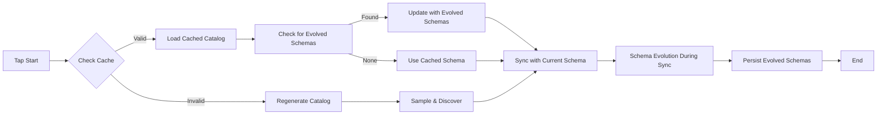

# Schema Persistence and Catalog Caching Solution

## Problem Solved

Your original question highlighted a critical issue: **catalog caching with stale schemas**. When schema evolution occurs during sync, the evolved schema wasn't persisted, causing subsequent runs to use outdated catalogs with missing columns.

## Comprehensive Solution

### 🔄 **Intelligent Catalog Management**



### 🏗️ **Architecture Components**

1. **`SchemaStateManager`** - Persistent schema state across runs
2. **`SchemaEvolutionManager`** - Runtime schema evolution logic
3. **Intelligent Catalog Caching** - Avoids unnecessary discovery
4. **Schema Versioning** - Track evolution history

## How It Solves the Caching Problem

### **Before** (Problem):
```
Run 1: Discover → Cache catalog → Sync → Schema evolves → ❌ Evolution lost
Run 2: Load stale cache → ❌ Missing new columns → Sync fails/incomplete
```

### **After** (Solution):
```
Run 1: Discover → Cache catalog → Sync → Schema evolves → ✅ Persist evolution
Run 2: Load cache → ✅ Update with evolved schemas → Sync with current schema
```

## Key Features

### 1. **Persistent Schema State**
```python
# Stores schema evolution across runs
{
  "schemas": {
    "customer_data": {
      "current_schema": {...},      # Latest evolved schema
      "original_schema": {...},     # Initial discovered schema
      "evolution_history": [...],   # All evolution events
      "last_evolved": "2024-01-15T10:30:00Z"
    }
  }
}
```

### 2. **Smart Cache Invalidation**
- **Configuration changes** → Regenerate catalog
- **Schema evolution enabled** → Check for evolved schemas
- **TTL expiration** → Refresh after time limit
- **Force flags** → Manual regeneration control

### 3. **Cache Configuration**
```json
{
  "disable_catalog_cache": false,         // Global cache disable
  "force_catalog_regeneration": false,    // Force fresh discovery
  "schema_cache_ttl_hours": 24,          // Cache lifetime
  "default_evolve_schema_during_sync": true
}
```

## Operational Scenarios

### 📈 **Scenario 1: New Field Added**

**Data Change:**
```csv
// Old: customer_id,name,email
// New: customer_id,name,email,phone
```

**System Response:**
```
1. Sync detects new 'phone' field
2. Schema evolves: merge mode adds field
3. New schema persisted to state
4. Next run uses evolved schema automatically
5. ✅ No manual intervention needed
```

### 🔄 **Scenario 2: Type Change**

**Data Change:**
```csv
// Old: customer_id (integer): 123, 456
// New: customer_id (UUID): 550e8400-e29b-41d4-a716-446655440000
```

**System Response:**
```
1. Sync detects type change integer → string
2. Schema evolves: safely widen to string type
3. Evolution recorded with type change details
4. ✅ Data continues flowing without errors
```

### ⚡ **Scenario 3: Performance Optimization**

**Without Caching:**
```
Discovery: Sample 1000s of files → 30-60 seconds
Every run: Full discovery overhead
```

**With Intelligent Caching:**
```
First run: Full discovery → Cache catalog
Subsequent runs: Load cache → ~1 second
Cache refresh: Only when needed (config/evolution/TTL)
```

## Configuration Examples

### 🏭 **Production Setup**
```json
{
  "schema_cache_ttl_hours": 48,           // Longer cache for stability
  "default_schema_evolution_mode": "merge", // Safe evolution
  "default_evolve_schema_during_sync": false, // Controlled evolution
  
  "tables": [{
    "name": "critical_data",
    "schema_evolution_mode": "strict",      // No surprises
    "evolve_schema_during_sync": false
  }]
}
```

### 🧪 **Development Setup**
```json
{
  "schema_cache_ttl_hours": 1,            // Frequent refresh
  "default_schema_evolution_mode": "replace", // Flexible evolution
  "default_evolve_schema_during_sync": true,  // Automatic evolution
  
  "tables": [{
    "name": "experimental_data",
    "schema_evolution_mode": "replace",     // Full flexibility
    "evolution_sample_size": 50           // Quick sampling
  }]
}
```

### 🔧 **Troubleshooting Setup**
```json
{
  "force_catalog_regeneration": true,     // Fresh start
  "disable_catalog_cache": true,          // No caching
  
  "tables": [{
    "schema_evolution_mode": "disabled",   // Manual control
    "schema_overrides": {
      "problematic_field": {"type": ["null", "string"]}
    }
  }]
}
```

## Monitoring and Operations

### 📊 **Schema Evolution Events**
```bash
# Monitor schema changes
grep "Schema evolved for stream" logs/tap.log

# View evolution history
cat .tap_schema_state.json | jq '.schemas.customer_data.evolution_history'
```

### 🧹 **Cache Management**
```bash
# Force fresh discovery
echo '{"force_catalog_regeneration": true}' | tap-spreadsheets-anywhere --discover

# Clear all caches
rm .tap_catalog_cache.json .tap_schema_state.json

# Check cache status
ls -la .tap_*.json
```

### 📈 **Performance Monitoring**
```bash
# Time discovery with/without cache
time tap-spreadsheets-anywhere --discover    # With cache
rm .tap_catalog_cache.json
time tap-spreadsheets-anywhere --discover    # Without cache
```

## Migration Guide

### 🔄 **From Existing Taps**

**Step 1 - Enable Basic Evolution:**
```json
{
  "schema_evolution_mode": "merge",
  "evolve_schema_during_sync": false  // Start conservative
}
```

**Step 2 - Monitor & Validate:**
```bash
# Run a few syncs and check for evolution events
grep -i "evolution\|schema" logs/tap.log
```

**Step 3 - Enable Runtime Evolution:**
```json
{
  "evolve_schema_during_sync": true,
  "evolution_sample_size": 100
}
```

**Step 4 - Optimize Caching:**
```json
{
  "schema_cache_ttl_hours": 24,  // Adjust based on data change frequency
  "disable_catalog_cache": false
}
```

## Best Practices Summary

### ✅ **Do**
- Start with `merge` mode for safety
- Use `schema_overrides` for critical fields
- Monitor evolution logs regularly
- Set appropriate cache TTL for your use case
- Test evolution in non-production first

### ❌ **Don't**
- Use `replace` mode in production without testing
- Disable caching unless necessary
- Ignore schema evolution warnings
- Set extremely short cache TTL (< 1 hour) in production

### 🎯 **Performance Tips**
- Use smaller `evolution_sample_size` for large files
- Set longer `schema_cache_ttl_hours` for stable schemas
- Enable `prefer_schema_as_string` for highly variable data

## Result

✅ **Catalog caching problem solved:** Evolved schemas persist across runs
✅ **Performance optimized:** Intelligent cache invalidation  
✅ **Safety maintained:** Configurable evolution modes
✅ **Transparency:** Full evolution history and monitoring
✅ **Flexibility:** Environment-specific configurations